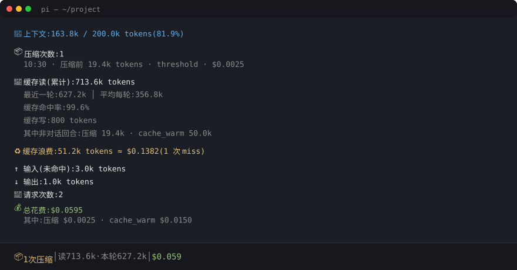

# pi-context-stats

[](https://pi.dev/packages)

Track context compaction, prompt-cache hits, and token spend in [pi](https://github.com/badlogic/pi-mono). **Zero dependencies, pure TypeScript, three small modules.**



## Status bar

```
📦1次压缩 │ 读713.6k·本轮627.2k │ $0.059
```

| Segment | Meaning |
|---|---|
| `📦N次压缩` | Session compactions so far (hidden until the first one) |
| `读X·本轮Y` | X = cumulative cacheRead tokens; Y = cacheRead of the latest turn |
| `$X.XXX` | Total session cost |

## `/ctxstats`

Full breakdown on demand:

- **Context usage** — estimated tokens / window / percent
- **Compaction history** — time, tokens before, reason, cost of the compaction call itself
- **Cache reads** — cumulative / latest turn / per-turn average / hit rate / cache writes
- **Cache waste** — tokens that *were* cached last turn but got re-billed as `input`/`cacheWrite` this turn, with the money it cost you. This is the number that actually hurts; hit rate alone hides it.
- **Non-turn usage breakdown** — compaction calls and `cache_warm` keep-alive refreshes
- **Input (uncached) / output / request count / total cost**, split by source

## Install

```bash
pi install npm:pi-context-stats
```

Or from a local path:

```bash
pi install /path/to/pi-context-stats
```

## Alerts

| When | Condition | Behavior |
|---|---|---|
| `message_end` / `turn_end` | session cost ≥ `$10` (default) | `warning`: 💰 cost threshold reached (once per session) |
| `message_end` / `turn_end` | context usage ≥ `85%` (default) | `warning`: 🧠 near compaction — persist important findings to files (once per session; resets after compaction) |
| `session_before_compact` | pi is about to compact | `info`: 📦 reason · tokens · willRetry — your last chance to decide on a manual `/compact` |

Thresholds are configurable in `~/.pi/agent/settings.json`:

```json
{
  "pi-context-stats": {
    "costLimit": 5,
    "contextPercent": 70
  }
}
```

## What gets counted

Three sources, not just chat turns:

| Source | Note |
|---|---|
| `message` (assistant) | Regular turns |
| `type:"usage"` entries | `cache_warm` keep-alive refreshes — pi counts them in session totals, but they never enter the context |
| `CompactionEntry.usage` | The compaction summarization call goes through `completeSimple`, which **never fires** `message_end` |

Compaction reasons exist only on the live `session_compact` event, not on the persisted entry. This extension writes them to a custom entry (`pi.appendEntry("context-stats.compaction", {id, reason})`) and back-fills by `entry.id` on resume/reload.

### Cache waste algorithm

Numerically identical to pi's built-in `computeCacheWaste` (verified with a 10-scenario cross-check):

- 1024-token noise floor — small dips don't count
- Compaction / branch summary resets the baseline (the next prompt is legitimately new)
- Model switches **still count** (full re-bill)
- `cache_warm` refreshes count as "the previous request"

### Known difference vs pi built-in

pi's own implementation returns `NaN` when a `cost` breakdown field is missing. This extension coalesces missing buckets to `0`, so the UI never shows `$NaN` — at the cost of being optimistic if a provider under-reports cost. Well-formed `Usage` from pi-ai has all four buckets, so this shouldn't trigger in practice.

## Development

```bash
npm test
```

Runs two suites in `test/`:

- `behavior.test.mjs` — 18 mocked behavior checks (accumulation, rebuild, thresholds, alerts, timing)
- `cache-waste-crosscheck.test.mjs` — 10 scenarios cross-checked against pi's built-in `computeCacheWaste`

Tests auto-detect the pi install directory (or honor `PI_INSTALL_DIR`) and need no `npm install` — the package has zero dependencies; even the test-only `jiti` comes from pi's own bundled modules.

## License

MIT
